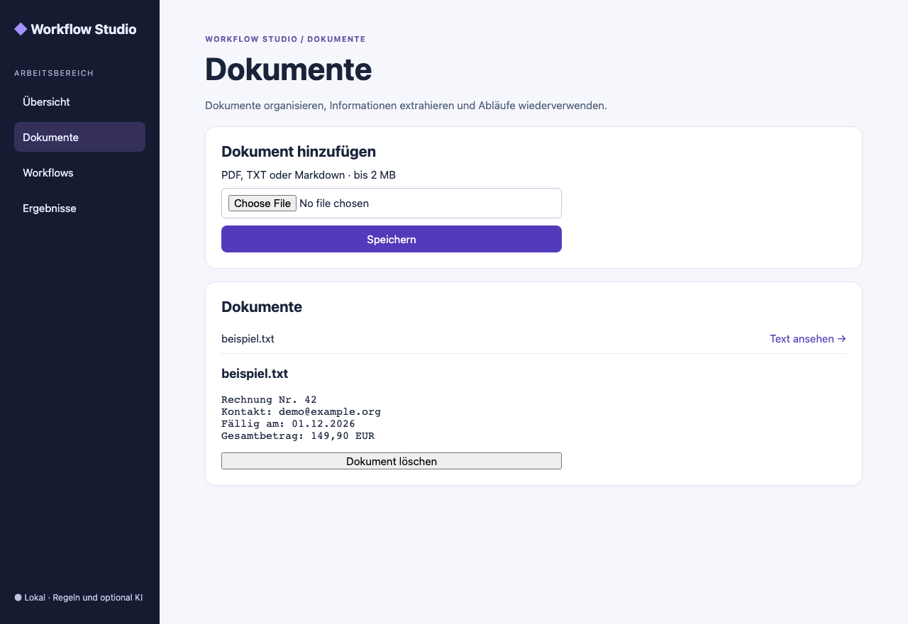
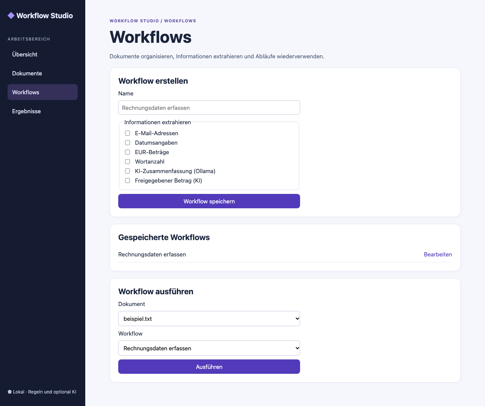
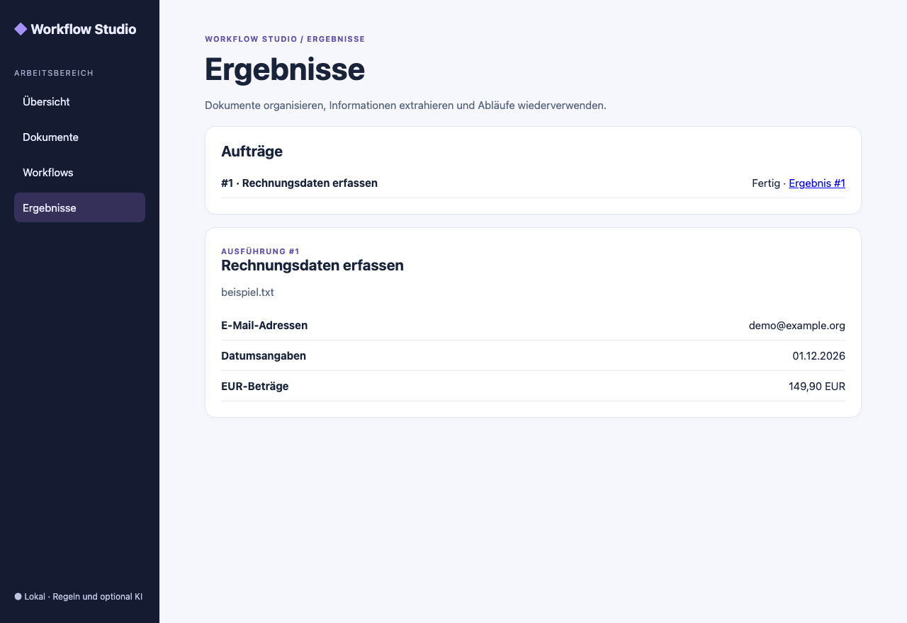
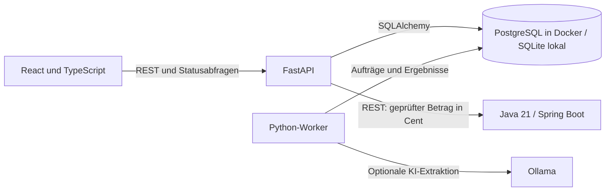

# Workflow Studio

[](https://github.com/ridalo99/ai-workflow-platform/actions/workflows/ci.yml)

Lokales Lernprojekt für Dokumentenverarbeitung. Lade eine Textdatei oder ein PDF mit Textebene hoch, speichere einen Extraktionsworkflow und wende ihn auf ein Dokument an. Das Dashboard zeigt Dokumente, Workflows und gespeicherte Ausführungen. Der Server speichert Dateinamen und Text, nicht die ursprünglichen Dateien.

## Demo

[Kurze Bildschirmaufnahme ansehen (WebM)](https://raw.githubusercontent.com/ridalo99/ai-workflow-platform/main/docs/demo/workflow-demo.webm)

Im Beispiel lädt Workflow Studio eine Rechnung als Textdatei, extrahiert E-Mail-Adresse, Datum und Betrag im Hintergrund und zeigt das gespeicherte Ergebnis.

### Dokument hochladen und prüfen



### Workflow konfigurieren und ausführen



### Ergebnis ansehen



## Architektur



Die API speichert Uploads und Workflow-Konfigurationen. Beim Start legt sie einen Auftrag an und antwortet mit HTTP 202. Der Worker verarbeitet den Auftrag und speichert das Ergebnis. React fragt den Status ab.

FastAPI besitzt Dokumente, Workflows und manuell geprüfte Beträge. Der Java-Service kapselt die Freigabepolitik als unabhängig testbaren REST-Vertrag. Er benötigt keine Datenbank und erhält ausschließlich den Betrag in Cent. Die Abfrage ist optional und kann auch für vorhandene Ausführungen mit gespeichertem Prüfwert verwendet werden.

## Freigaberegel für geprüfte Beträge

Nach dem Speichern des Prüfwerts kannst du die Entscheidung unter [FastAPI OpenAPI](http://localhost:8000/docs) abrufen. Die Beispielgrenze ist konfigurierbar und beträgt standardmäßig **5.000,00 EUR** (`APPROVAL_THRESHOLD_CENTS=500000`). Ein Betrag bis einschließlich der Grenze erhält `AUTO_APPROVED`. Höhere Beträge erhalten `MANUAL_REVIEW`. Das Ergebnis ist eine Live-Auswertung und wird nicht gespeichert.

| API | Methode und Pfad | Vertrag |
| --- | --- | --- |
| FastAPI | `GET /api/runs/{id}/approval` | Liefert die aktuelle Entscheidung für den gespeicherten Prüfwert. HTTP 404 bei fehlender Betragsextraktion, 409 bei fehlendem Prüfwert, 503 bei Verbindungsfehler oder Timeout und 502 bei einer fehlerhaften Antwort des Dienstes. |
| Spring Boot | `POST /api/approvals/evaluate` | Erwartet `{"amountCents":320050}`. Liefert z. B. `{"status":"AUTO_APPROVED","thresholdCents":500000}`. Ungültige Eingaben liefern HTTP 400. |

Compose verwendet intern `http://approval:8080`. Ohne Docker startest du den Dienst mit JDK 21 und Maven über `mvn -f approval-service/pom.xml spring-boot:run`. FastAPI nutzt dann standardmäßig `http://127.0.0.1:8080`. Die Adresse kannst du mit `APPROVAL_SERVICE_URL` anpassen.

## Automatisierte Checks

GitHub Actions führt bei jedem Push und Pull Request die Python-Tests und den React-Produktionsbuild sowie die Java-21-Tests als getrennte Jobs aus. Die Fehlertests prüfen abgelehnte Uploads, Verbindungsfehler zu Ollama, ungültige Modellantworten und die Wiederaufnahme wartender Aufträge nach einem Worker-Neustart. Die Ollama-Tests simulieren HTTP-Antworten und laufen ohne Modellinstallation.

Java-Tests lokal ausführen mit `mvn -f approval-service/pom.xml verify`. Die JUnit-Tests prüfen Grenzwerte und ungültige JSON-Eingaben über Spring MVC. Die FastAPI-Tests prüfen den HTTP-Vertrag, die Verwendung des gespeicherten Prüfwerts sowie die Fehlerbehandlung und den weiterhin verfügbaren Export.

Bei der Einführung des Freigabedienstes liefen lokal **10 JUnit-5-Testfälle mit Java 21** und **22 Python-Tests** erfolgreich.

## Start

Mit Docker Desktop: `docker compose up --build`. Öffne http://localhost:5173 für die App und http://localhost:8000/docs für die OpenAPI-Oberfläche. Compose verwendet PostgreSQL.

Ohne Docker (Python 3.13 und Node.js 22.12+): im Projektordner:

```sh
python3 -m venv .venv
.venv/bin/pip install -r requirements.txt
.venv/bin/uvicorn app:app --reload
```

Zweites Terminal, ebenfalls im Projektordner:

```sh
npm --prefix frontend ci
npm --prefix frontend run dev
```

Dieser Modus verwendet standardmäßig SQLite. Beide Varianten sind lokale Einzelplatz-Demos ohne Anmeldung. Zum Ausprobieren Beispieldaten verwenden.

## Dein erster Durchlauf

1. Lade `beispiel.txt` unter „Dokumente“ hoch und öffne die Textvorschau.
2. Lege unter „Workflows“ einen Workflow „Rechnung“ mit E-Mail, Datum und Betrag an.
3. Wähle das Dokument und den Workflow und klicke „Ausführen“.
4. Du solltest `demo@example.org`, `01.12.2026` und `149,90 EUR` sehen. Lade die Seite neu: Das Ergebnis bleibt in der Datenbank.

## Lerne den Datenfluss

- **HTTP:** Öffne `/docs` und führe `GET /api/documents` aus. Vergleiche die Antwort mit der Dokumentliste in React. Finde die entsprechende Anfrage in den Browser-Entwicklertools unter Netzwerk.
- **Datenbank:** Lies in `app.py` zuerst die drei SQLAlchemy-Modelle. Ein Run verbindet eine Dokument-ID mit einer Workflow-ID und speichert das Ergebnis.
- **Tests:** Führe `.venv/bin/python -m pytest -q` aus. Ändere testweise die E-Mail in `test_app.py` nur beim Upload und erkläre, warum der Vergleich fehlschlägt. Mache die Änderung wieder rückgängig.
- **Erste eigene Änderung:** Ergänze in `PATTERNS` eine Regel für Rechnungsnummern. Ergänze den Schlüssel in `FIELDS` und im React-Objekt `labels` und teste die neue Auswahl. Überlege, an welcher Stelle der neue Wert validiert wird.

## Nächste Meilensteine

Datenbankmigrationen, Anmeldung, Trennung der Nutzerdaten, OCR und produktionsfähige Bereitstellung.

Aktuell erkennt die Extraktion Textmuster, prüft aber keine semantische Richtigkeit von Datumsangaben oder Geldbeträgen. PDF-Bildscans benötigen OCR. Es gibt keine zeitgesteuerte Ausführung und keinen gehosteten Betrieb.

## Workflows ändern und Dokumente verwalten

Unter „Gespeicherte Workflows“ kannst du Name und Felder ändern. Ergebnisse früherer Ausführungen behalten ihre Werte. Beim Löschen eines Dokuments werden auch die zugehörigen Ergebnisse gelöscht.

## Optional: lokale KI-Zusammenfassung mit Ollama

1. [Ollama](https://ollama.com/) lokal starten und `ollama pull qwen2.5:3b` ausführen.
2. In Workflows „KI-Zusammenfassung (Ollama)“ auswählen und ein kurzes Testdokument ausführen (maximal 6.000 Zeichen). Regelbasierte Felder funktionieren weiterhin ohne Ollama.
3. Ohne Docker verwendet die API standardmäßig `http://127.0.0.1:11434`. Docker Desktop verwendet `http://host.docker.internal:11434`. Falls der Dienst aus Docker nicht erreichbar ist, teste zunächst den Start ohne Docker. Modell und Ziel lassen sich serverseitig über `OLLAMA_MODEL` und `OLLAMA_URL` konfigurieren. Verwende einen lokalen Dienst, damit Inhalte auf deinem Gerät bleiben.

Der Adapter in `extraction.py` schickt Dokumenttext erst bei einer ausdrücklich gewählten KI-Ausführung an den konfigurierten Server. Er fordert ein JSON-Schema an und validiert die Antwort. Das prüft ihre Form, nicht die sachliche Richtigkeit. Der automatisierte Test verwendet eine simulierte Ollama-Antwort. Für einen echten Modelltest vergleiche die Zusammenfassung mit dem Original und erkläre, welche Fakten das Modell übernommen oder weggelassen hat.

### Freigegebenen Betrag mit Beleg extrahieren

Wähle „Freigegebener Betrag (KI)“ und führe den Workflow auf `beispiel-komplex.txt` aus. Erwartet sind **3.200,00 EUR** und ein Zitat zum freigegebenen Festpreis. Der Server nummeriert Beträge mit ihren Originalabsätzen. Ollama wählt eine Nummer oder meldet, dass kein Betrag eindeutig freigegeben wurde. Die App übernimmt das Zitat aus dem Dokument; ob es eine Freigabe belegt, bleibt manuell zu prüfen.

### Betrag prüfen und exportieren

Öffne eine Ausführung mit „Freigegebener Betrag (KI)“. Vergleiche den Vorschlag mit dem Original und speichere den bestätigten oder korrigierten Wert im Feld „Geprüfter Betrag“ (z. B. `3.200,00 EUR`). Auch wenn die KI keinen Betrag gefunden hat, kannst du ihn manuell eintragen. Der KI-Vorschlag bleibt unverändert. Erst nach dem Speichern stehen CSV (Semikolon als Trennzeichen) und JSON zum Download bereit. Beide enthalten Ausführungs-ID, Dokument-ID und Prüfwert. Änderungen im Eingabefeld wirken erst nach dem Speichern auf den Export.

Lernaufgabe: Exportiere vor und nach dem Speichern über die API und erkläre, warum du zuerst HTTP 409 bekommst. Vergleiche anschließend KI-Vorschlag und Prüfwert in `GET /api/runs`.

### Workflows im Hintergrund

Die Oberfläche sendet `POST /api/jobs` und bekommt sofort HTTP 202 mit einer Auftrags-ID. Der separate Worker verarbeitet die in der Datenbank gespeicherten Aufträge. React fragt `GET /api/jobs` alle 1,5 Sekunden ab, solange Aufträge aktiv sind. Ein Neuladen verliert den Auftrag nicht. Erfolgreiche Aufträge verlinken auf die gespeicherte Ausführung. Bei Fehlern kannst du den Workflow erneut starten.

Mit Docker startet `docker compose up --build` den Worker automatisch. Ohne Docker zusätzlich im Projektordner `.venv/bin/python worker.py` mit derselben Datenbankkonfiguration wie das Backend starten. Pro Datenbank nur eine Worker-Instanz starten. Beim Worker-Neustart werden unterbrochene Aufträge als fehlgeschlagen markiert; wartende Aufträge bleiben erhalten.

Lerncheck: Starte einen Ollama-Auftrag und lade die Seite neu. Beobachte im Netzwerk-Tab den Unterschied zwischen HTTP 202 beim Start und den anschließenden Statusabfragen. Schalte für einen zweiten Versuch Ollama aus und prüfe die Fehlermeldung unter „Ergebnisse“.
